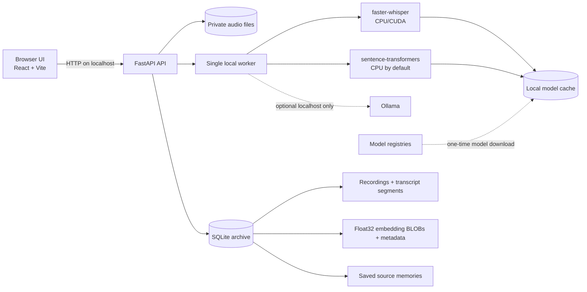

# LastWhisper

LastWhisper is a local-first voice memory archive. It imports personal audio, transcribes it with open-source Whisper inference, indexes transcript evidence with local sentence-transformer embeddings, and lets people search, replay, and save source-grounded memories.

No hosted transcription, embedding, LLM, analytics, or telemetry service is required. Model files may need a one-time download before offline use.

## Features

- Private local audio archive for WAV, MP3, M4A, and FLAC files.
- CPU-first transcription with `faster-whisper`, language detection, progress, retry, and cancellation.
- Native playback and timestamped transcript segments that seek into the source audio.
- Optional source-grounded summaries through a user-configured local Ollama model.
- Local semantic search with normalized sentence-transformer embeddings stored in SQLite.
- Evidence snippets with recording IDs, segment IDs, dates, and source timestamps.
- Saved memories with immutable source evidence plus editable titles and notes.
- Rebuildable, transcript-revision-aware search index.
- Additive migration support for existing Phase 1, Phase 2, and early Phase 3 databases.
- Responsive React interface, local API readiness checks, and persistent Docker volumes.

## Architecture



The API and worker intentionally run in one process. Use exactly one Uvicorn worker: the transcription queue, cancellation locks, and model caches are process-local.

## Requirements

Verified release environment:

- Linux x86_64
- Python 3.13
- Node.js 20.19
- CPU with AVX support; 8 GB RAM minimum, 12 GB recommended
- Approximately 3 GB free for the Python environment and default model caches
- FFmpeg is recommended for generating/converting compatible audio

Windows and macOS should work with compatible PyTorch/CTranslate2 wheels but were not verified for this release. CUDA requires a compatible NVIDIA driver, CUDA libraries, CTranslate2, and PyTorch build; CPU is the supported default.

## Native Setup

From the repository root:

```bash
python -m venv .venv
source .venv/bin/activate                 # Windows: .venv\Scripts\activate
python -m pip install --upgrade pip
python -m pip install -r backend/requirements-dev.txt
cp .env.example backend/.env
```

Linux x86_64 installs the pinned CPU-only PyTorch wheel by default. Then run the API with one worker:

```bash
PYTHONPATH=backend uvicorn app.main:app --host 127.0.0.1 --port 8000 --workers 1
```

In another terminal:

```bash
cd frontend
npm ci
cp .env.example .env
npm run dev
```

Open `http://localhost:5173`. API liveness is at `http://127.0.0.1:8000/api/health`; database/storage readiness is at `/api/ready`.

## Model Setup

### Whisper

Default CPU settings:

```env
WHISPER_MODEL=base
WHISPER_REVISION=ebe41f70d5b6dfa9166e2c581c45c9c0cfc57b66
WHISPER_DEVICE=cpu
WHISPER_COMPUTE_TYPE=int8
WHISPER_DOWNLOAD_ROOT=./data/models/whisper
WHISPER_LOCAL_FILES_ONLY=false
```

The first transcription downloads the selected CTranslate2 Whisper model unless it is cached. After one successful load, set `WHISPER_LOCAL_FILES_ONLY=true` to prevent network fallback. `tiny` is faster and less accurate; `base` is the practical CPU default. Larger models require more memory and processing time. If you change `WHISPER_MODEL`, also set a revision belonging to that model (or explicitly clear the revision to follow its mutable default branch).

For CUDA, install the correct CUDA-enabled PyTorch wheel for the host, set `WHISPER_DEVICE=cuda`, and use a supported compute type such as `float16`. Native setup is recommended for GPU inference; the supplied Docker configuration is CPU-only.

### Sentence embeddings

```env
EMBEDDING_MODEL=sentence-transformers/paraphrase-multilingual-MiniLM-L12-v2
EMBEDDING_REVISION=e8f8c211226b894fcb81acc59f3b34ba3efd5f42
EMBEDDING_DEVICE=cpu
EMBEDDING_CACHE_DIR=./data/models/embeddings
EMBEDDING_LOCAL_FILES_ONLY=false
```

Pre-cache the pinned model while online:

```bash
PYTHONPATH=backend python -c "from app.search import get_embedder; get_embedder(); print('embedding cache ready')"
```

Then set `EMBEDDING_LOCAL_FILES_ONLY=true`. The status endpoint deliberately reports `not_loaded` until the model successfully loads; package installation alone does not prove the weights are cached.

### Optional Ollama

Transcription and search do not require an LLM. To enable local summaries:

```env
OLLAMA_MODEL=llama3.2:3b
OLLAMA_URL=http://127.0.0.1:11434
ALLOW_REMOTE_OLLAMA=false
```

LastWhisper sends the complete transcript to the configured Ollama endpoint. Remote Ollama hosts are rejected by default. Model licensing and hardware requirements vary; verify the selected Ollama model before redistribution or submission.

## Offline Operation

LastWhisper is offline-capable only after dependencies and model weights are cached.

1. Install Python and npm dependencies while online.
2. Load both configured models successfully once.
3. Set `WHISPER_LOCAL_FILES_ONLY=true` and `EMBEDDING_LOCAL_FILES_ONLY=true`.
4. Optionally set `HF_HUB_OFFLINE=1` and `TRANSFORMERS_OFFLINE=1`.
5. Disconnect networking and run transcription plus search again.

The release verification performed this cached/offline reload for both default models. A different machine, model, revision, device, or cache must be verified separately.

## Docker CPU Setup

Docker keeps archives and model caches in named volumes and exposes only the frontend on loopback:

```bash
docker compose up --build
```

Open `http://127.0.0.1:8080`. The first inference can download model files into `lastwhisper_models`; archive data persists in `lastwhisper_data`.

Useful commands:

```bash
docker compose ps
docker compose logs -f backend
docker compose down                       # keep volumes
docker compose down --volumes             # permanently delete archive and model volumes
```

Do not expose the container ports publicly. There is no user authentication. See [`docs/PRIVACY_SECURITY.md`](docs/PRIVACY_SECURITY.md).

## Persistence

Native defaults are anchored to `backend/`, independent of the shell working directory:

- Database: `backend/data/lastwhisper.sqlite3`
- Audio: `backend/data/audio/`
- Suggested models: `backend/data/models/`

Directories are tightened to owner-only permissions where the operating system supports POSIX modes. SQLite, transcripts, notes, embeddings, and audio are plaintext local data. Back up the whole `backend/data/` directory while the API is stopped.

## Semantic Index Representation

Completed transcript segments are grouped into bounded overlapping chunks. Overlong segments retain their exact Whisper segment bounds instead of receiving invented sub-segment timestamps. Each embedding is normalized and stored as a little-endian float32 SQLite BLOB with:

- Recording and primary source segment IDs.
- All contributing source segment IDs.
- Source timestamps and faithful text.
- Embedding model, immutable revision, dimension, and format assumptions.
- Transcript fingerprint and chunker configuration.

Cosine similarity is a ranking signal from `-1` to `1`, not a probability or factual-confidence score. `SEARCH_MIN_SIMILARITY` controls the cutoff. Search returns transcript evidence only; it does not synthesize an answer.

## API Overview

- `GET /api/health` and `GET /api/ready`
- `GET /api/recordings` and `GET /api/recordings/stats`
- `POST /api/recordings/import` (`file` multipart field)
- `GET/PATCH/DELETE /api/recordings/{id}`
- `GET /api/recordings/{id}/audio`
- `POST /api/recordings/{id}/transcribe`
- `POST /api/recordings/{id}/transcribe/cancel`
- `POST /api/search`
- `GET /api/search/status`
- `POST /api/search/rebuild` with `{"confirm": true}`
- `GET/POST /api/memories`
- `PATCH/DELETE /api/memories/{id}`

Re-transcription requires `replace_existing=true` when a transcript already exists because successful replacement deletes saved memories linked to old source segment IDs. Failure or cancellation keeps the previous transcript, summary, index, and saved memories.

## Testing

Normal tests never download models:

```bash
PYTHONPATH=backend python -m pytest -q backend/tests -m "not integration"
cd frontend
npm test
npm run typecheck
npm run lint
npm run build
npm audit --audit-level=moderate
```

Real-model integration is opt-in and requires cached weights plus two short WAV files:

```bash
RUN_REAL_MODEL_TESTS=1 \
REAL_AUDIO_FILE=/absolute/path/first.wav \
REAL_AUDIO_FILE_2=/absolute/path/second.wav \
WHISPER_DOWNLOAD_ROOT=/absolute/path/whisper-cache \
WHISPER_LOCAL_FILES_ONLY=true \
EMBEDDING_CACHE_DIR=/absolute/path/embedding-cache \
EMBEDDING_LOCAL_FILES_ONLY=true \
HF_HUB_OFFLINE=1 TRANSFORMERS_OFFLINE=1 \
PYTHONPATH=backend python -m pytest -q -m integration backend/tests/integration
```

See [`docs/VERIFICATION.md`](docs/VERIFICATION.md) for the actual release run and its limitations.

## Privacy and Security

- No hosted AI API, analytics SDK, or telemetry is included.
- Uploads receive generated filenames and are kept outside the web root.
- Extensions, MIME hints, size, and format signatures are validated.
- Database queries use SQLAlchemy parameterization.
- Audio responses are non-cacheable and served inline with canonical MIME types.
- Recording deletion cascades database evidence and stages filesystem deletion safely.
- Trusted hosts and CORS default to loopback development origins.
- Remote Ollama endpoints are disabled by default.
- The API has no authentication or encryption at rest. Do not bind it to a public or shared network.

Model registries receive model identifiers and download requests during first-time setup, but not recordings or transcript text. See the privacy document for the complete trust boundary.

## Troubleshooting

**The embedding model is unavailable**

- Confirm `sentence-transformers` is installed.
- Confirm the configured model and revision match the cache.
- Temporarily set `EMBEDDING_LOCAL_FILES_ONLY=false` while online, load once, then restore it to `true`.

**Whisper cannot load on CPU**

- Use `WHISPER_DEVICE=cpu` and `WHISPER_COMPUTE_TYPE=int8`.
- Confirm `faster-whisper`, CTranslate2, and the pinned compatible PyAV release installed from `requirements.txt`.
- Try `WHISPER_MODEL=tiny` on constrained systems.

**CUDA fails**

- Confirm driver, CUDA, PyTorch, and CTranslate2 compatibility.
- Fall back to CPU settings before filing an application bug.

**The archive appears empty**

- Confirm `DATABASE_URL` and `STORAGE_DIR` in `backend/.env`.
- Current defaults are anchored to `backend/`; older development runs may have created a root-level `data/` directory.

**Search finds nothing after transcription**

- Open Memory Search and inspect model/index status.
- Run Rebuild index.
- Lower `SEARCH_MIN_SIMILARITY` carefully; the score is not a probability.

**Docker model download is slow**

- Model files persist in the model volume after the first successful load.
- Native setup is usually faster to diagnose and is recommended for demos and GPU use.

## Open Source and Challenge

LastWhisper is released under the [MIT License](LICENSE). Contributions are welcome through [`CONTRIBUTING.md`](CONTRIBUTING.md). Security reports should follow [`SECURITY.md`](SECURITY.md).

The project was prepared for the **Hacktoberfest Open-Source AI Challenge: Week 4**, whose “Ghost in the Machine” prompt explicitly includes a local oral-history tool that preserves family stories. The required DEV submission and `#hf26challenge` post are separate from this repository release; no submission is automatically published.

- Demo flow: [`docs/DEMO_SCRIPT.md`](docs/DEMO_SCRIPT.md)
- Detailed architecture: [`docs/ARCHITECTURE.md`](docs/ARCHITECTURE.md)
- Model and dependency notices: [`docs/MODEL_LICENSES.md`](docs/MODEL_LICENSES.md)
- Release history: [`CHANGELOG.md`](CHANGELOG.md)

## Limitations

- Semantic scoring is a linear SQLite scan suitable for a personal MVP archive, not millions of chunks.
- Index rebuilds and model inference run in the API process.
- Only one API worker is supported.
- Cancellation is cooperative and cannot interrupt a native inference call mid-segment.
- Saved memories are source-linked and are removed after confirmed successful re-transcription.
- Optional summary quality and license depend on the user-selected Ollama model.
- Browser audio seeking was implemented and build-tested, but automated real-browser media playback was not part of the release environment.
