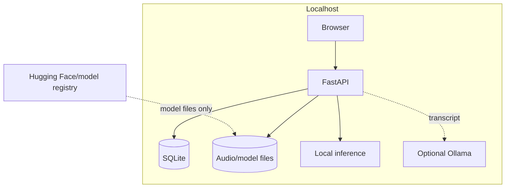

# Architecture

## Components

| Component | Responsibility |
| --- | --- |
| React + Vite frontend | Archive, playback, transcription controls, evidence search, and saved-memory UI |
| FastAPI application | Validated local API, file delivery, lifecycle, and readiness |
| SQLAlchemy + SQLite | Recordings, transcript segments, index metadata, embedding BLOBs, and saved memories |
| Single transcription worker | Serialized faster-whisper jobs and optional Ollama enrichment |
| Sentence-transformer provider | Lazy, cached local embedding generation |
| Filesystem store | UUID-named private audio and model caches outside the web root |

## Data Flow

1. The browser sends a multipart audio file to the loopback API.
2. The API validates size, extension, MIME hint, and file signature, then stores a UUID-named private file.
3. A single worker loads cached/downloaded Whisper weights and produces timestamped transcript segments.
4. Successful transcript replacement, old-source cleanup, and recording status update occur transactionally.
5. The indexer fingerprints ordered segment IDs, timestamps, and text; chunks source evidence with overlap; and generates normalized embeddings.
6. SQLite stores each vector as little-endian float32 bytes with model revision, dimension, transcript hash, segment IDs, text, and timestamps.
7. Search embeds the query locally, validates compatible current chunks, scores cosine similarity, applies the configured threshold, and returns source evidence.
8. Saving a result snapshots the evidence but retains a foreign key to a real source segment.

## Trust Boundaries

The browser/API boundary is not authenticated. The supported protection is loopback binding plus trusted-host configuration. A remote API or Ollama URL changes the privacy boundary and must be treated as an explicit deployment decision.

## Concurrency

- Uvicorn must run with one worker.
- The transcription executor has one native-inference worker and a bounded reservation count.
- Cancellation and transcript finalization share a lock.
- Search index mutations are serialized per recording and re-check transcript state after acquiring SQLite's write lock.
- Rebuild has one process-wide lock and continues past recording-specific failures.

## Migrations

Startup runs an idempotent SQLite bridge. Phase 2 columns are additive. Phase 3 may recreate only derived search tables when an incompatible early development schema is detected. Recording, transcript, audio, and valid saved-memory data are preserved. Future destructive schema changes should move to Alembic.

## Deployment Constraints

- One backend process and one worker.
- Persistent database/audio and model-cache storage.
- Loopback or an authenticated reverse proxy; never direct public exposure.
- Native setup recommended for GPU and model troubleshooting.
